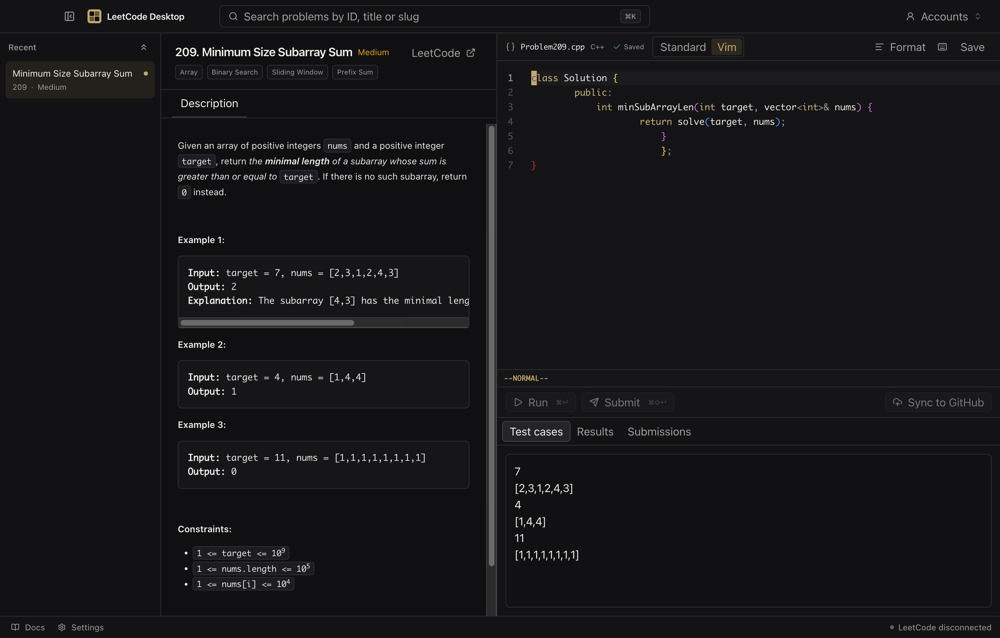

# LeetCode Desktop

A dark, keyboard-first LeetCode desktop client for macOS with a C++ Monaco editor, local draft retention and deliberate GitHub synchronisation.



## Status

Implemented:

- Secure Electron main, preload and sandboxed renderer architecture.
- Live LeetCode GraphQL problem search, problem detail and C++ starter templates.
- Per-problem SQLite drafts, editor state, 500 ms autosave and 30-day retention.
- Optional Vim editing with persistent Standard/Vim mode and a live Vim status bar.
- Local `.clang-format` configuration, presets, live preview and offline WASM formatting.
- Playwright persistent-profile LeetCode login without cookie copying.
- Authenticated C++ Run, Submit, polling, submission history, source preview and statistics.
- GitHub device authorisation, encrypted token storage and repository/branch verification.
- GitHub sync from the latest server-recorded Accepted C++ submission only.
- Bundled documentation, keyboard navigation, accessible Radix dialogs, tests and Electron packaging.

Live-account gates:

- The LeetCode judge and submission-history contracts are implemented against the current website shape, but require an authorised LeetCode account for final live verification.
- GitHub sign-in requires a registered OAuth App or GitHub App client ID with device flow enabled.
- A signed and notarised DMG requires an Apple Developer signing identity and credentials.

LeetCode’s internal endpoints are unofficial and may change. The application never bypasses authentication challenges or anti-bot controls.

## Requirements

- macOS on Apple Silicon for the packaged target.
- Node.js 22.12 or newer.
- Corepack and Yarn 4.
- A GitHub OAuth App or GitHub App with device flow enabled for GitHub sync.
- An Apple Developer identity only for signed distribution.

## Development

```sh
corepack enable
yarn install
yarn dev
```

`yarn install` rebuilds native dependencies and installs Playwright Chromium into `resources/playwright/`. To install only the browser:

```sh
yarn install:browser
```

Useful commands:

```sh
yarn typecheck
yarn lint
yarn test
yarn build
yarn test:e2e
yarn package:dir
yarn package
```

`yarn package` creates an arm64 DMG and ZIP in `release/`. Unsigned local builds are suitable for testing only.

## Authentication

### LeetCode

Open **Accounts**, select **Connect**, and sign in through the dedicated Playwright Chromium window. The app stores that profile under Electron’s user-data directory. Cookies and CSRF values remain in the main process.

### GitHub

Create an OAuth App or GitHub App, enable device authorisation, and enter its public client ID in **Settings**. No client secret belongs in this application. GitHub tokens are encrypted with Electron `safeStorage` and stored with owner-only file permissions.

## GitHub synchronisation

Use the visible **Sync to GitHub** action in a problem workspace. Before any write, the app:

1. Retrieves the latest Accepted C++ submission recorded by LeetCode.
2. Fetches that exact submission’s source from LeetCode.
3. Checks the selected branch for case-insensitive path conflicts.
4. Shows the accepted source and any differing remote file.
5. Uses the required path `<difficulty>/Problem<ID>.cpp` and exact commit subject `Upload problem [id] to [difficulty]/[filenamewithextension]`.
6. Reports success only after GitHub returns a commit SHA.

The editor buffer is never used as a substitute for accepted server-side code.

## Architecture

```text
React renderer (no Node, secrets or arbitrary network access)
        |
        | validated, typed preload IPC
        |
Electron main process
        |-- LeetCode GraphQL + authenticated website transport
        |-- Playwright persistent Chromium session
        |-- C++ judge and submission services
        |-- GitHub REST + OS-encrypted token storage
        `-- SQLite attempts and non-secret settings
```

See the bundled **Docs** area or the Markdown files in [`docs/`](docs/) for setup, shortcuts, storage, troubleshooting, privacy and API limitations.

The editor supports **Format** through the toolbar, `Option+Shift+F` and Monaco’s
Format Document action. Formatting is always local and never runs automatically
before Run, Submit or GitHub Sync.

## Security and privacy

- Renderer sandboxing, context isolation, no Node integration and a restrictive CSP are enforced.
- IPC inputs are validated with Zod and every sender is checked.
- LeetCode problem HTML is sanitised in the main process.
- External links are restricted to approved HTTPS origins.
- LeetCode cookies and GitHub tokens never enter renderer state or SQLite.
- Local attempts contain source code and problem metadata only, and are removed after 30 days without activity.

## Attribution

LeetCode and GitHub are trademarks of their respective owners. This project is not affiliated with either service.

